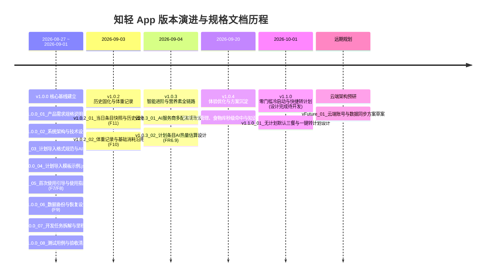

# 知轻 · 设计与规格文档库（spec）

安卓减脂计划打卡提醒 App ｜ Flutter（自 uni-app 迁移，1:1 兼容）｜ 单机离线优先

---

## 📅 版本迭代演进与文档归属映射

本目录下的所有文档均以 **`版本号_序号_中文名`** 命名规范编排，在文件管理器与 IDE 资源管理器中按文件名排序即可呈现完整的版本演进历史：

---

## 📚 文档分类与版本对应总览表

### 一、 核心基础与架构规范
| 文件名（按排序） | 所属版本 | 核心方案与职责 | 创建时间 |
| :--- | :---: | :--- | :---: |
| **[v1.0.0_01_产品需求规格说明书.md](v1.0.0_01_产品需求规格说明书.md)** | `v1.0.0 ~ v1.0.3` | 全局需求定义：功能清单（F1-F11）、验收标准与非功能要求 | 2026年08月27日 |
| **[v1.0.0_02_系统架构与技术设计.md](v1.0.0_02_系统架构与技术设计.md)** | `v1.0.0 / v1.0.2` | Flutter 整体架构、Provider 单例、前台交互与本地精确闹钟调度 | 2026年08月27日 |
| **[v1.0.0_03_计划导入格式规范与AI提示词.md](v1.0.0_03_计划导入格式规范与AI提示词.md)** | `v1.0.0` | 计划导入 JSON 格式规范表、容错校验与 AI 提示词 | 2026年08月27日 |
| **[v1.0.0_04_计划导入模板示例.json](v1.0.0_04_计划导入模板示例.json)** | `v1.0.0` | 内置导入模板数据源（7 餐食 / 4 运动真实样例） | 2026年08月27日 |

---

### 二、 专项业务功能设计方案
| 文件名（按排序） | 所属版本 | 核心方案与职责 | 创建时间 |
| :--- | :---: | :--- | :---: |
| **[v1.0.0_05_首次使用引导与使用指南设计.md](v1.0.0_05_首次使用引导与使用指南设计.md)** | `v1.0.0` | **F7/F8 引导体系**：4 步首充体验、资料录入、防重复引导与使用指引文章 | 2026年09月01日 |
| **[v1.0.0_06_数据备份与恢复设计.md](v1.0.0_06_数据备份与恢复设计.md)** | `v1.0.0 / v1.0.2` | **F9 备份与恢复**：10 项数据快照导出导入、单文件滚动覆盖本地自动备份 | 2026年09月01日 |
| **[v1.0.2_01_当日条目快照与历史固化设计.md](v1.0.2_01_当日条目快照与历史固化设计.md)** | `v1.0.2` | **F11 快照机制**：DayEntry 统一模型、修改即脱钩、历史数据固化防漂移 | 2026年09月03日 |
| **[v1.0.2_02_体重记录与基础消耗沿用设计.md](v1.0.2_02_体重记录与基础消耗沿用设计.md)** | `v1.0.2` | **F10 体重记录**：基准固化 + 按日沿用链，历史缺口稳定机制，结合个人资料 | 2026年09月03日 |
| **[v1.0.3_01_AI服务商多配置管理设计.md](v1.0.3_01_AI服务商多配置管理设计.md)** | `v1.0.3` | 多 AI 服务商档案（AiProfile）管理、激活指针无缝切换、凭证安全隔离 | 2026年09月04日 |
| **[v1.0.3_02_计划条目AI热量估算设计.md](v1.0.3_02_计划条目AI热量估算设计.md)** | `v1.0.3` | 计划全量编辑器 ✨ AI 估算、结构化食材与做法拼装描述、行内拆解展示 | 2026年09月04日 |
| **[v1.1.0_01_无计划默认三餐与一键转计划设计.md](v1.1.0_01_无计划默认三餐与一键转计划设计.md)** | **`v1.1.0`** *(待落地)* | **零门槛冷启动**：默认空白早中晚三餐；**一键转日常计划**；旧计划周期冲突检测与精准裁剪覆盖；全套测试边界矩阵 | **2026年10月01日** |
| **[v1.2.0_01_今日校验与三方AI自动纠偏设计.md](v1.2.0_01_今日校验与三方AI自动纠偏设计.md)** | **`v1.2.0`** | **F12 今日校验**：全天摄入/消耗条目总结、一键复制问第三方AI、端侧多级匹配自动纠偏 | **2026年10月06日** |
| **[vFuture_01_云端账号与数据同步方案草案.md](vFuture_01_云端账号与数据同步方案草案.md)** | `远期规划` | 远期云端多端同步方案预研：Fastify/FastAPI + SQLite + 快照同步 | 2026年09月03日 |

---

### 三、 项目研发流程与质量保障
| 文件名（按排序） | 所属版本 | 核心方案与职责 | 创建时间 |
| :--- | :---: | :--- | :---: |
| **[v1.0.0_07_开发任务拆解与里程碑.md](v1.0.0_07_开发任务拆解与里程碑.md)** | `v1.0.0 ~ 至今` | Phase 0 至 Phase 13 阶段性研发任务追踪与执行记录 | 2026年08月27日 |
| **[v1.0.0_08_测试用例与验收清单.md](v1.0.0_08_测试用例与验收清单.md)** | `v1.0.0 ~ 至今` | 各模块验收清单、真机兼容测试矩阵与发版前回归检查项 | 2026年08月27日 |

---

## 💡 产品核心原则

1. **以轻为本**：核心链路仅为「**记餐/定计划 $\to$ 到点提醒 $\to$ 打卡 $\to$ 缺口统计**」，无开屏广告、无社交臃肿、无无意义推送。
2. **极速可用**：用户甚至无需制定复杂计划，打开即可记餐；常用搭配一键转日常计划，用最自然的路径沉淀生活习惯。
3. **数据主权在用户**：单机离线优先，数据全部保存在手机本地；提供完整可读的纯文本 JSON 备份导出能力，随时可自由迁出。
4. **科学热量核算**：基础代谢按日沿用链固化历史缺口，计划与打卡快照解耦，支持 KFC/外卖常用库离线秒查与 AI 智能测算兜底。

---

**文档元信息**
- 所属版本：全版本索引导航
- 创建时间：2026年08月27日
- 最后更新：2026年10月01日
