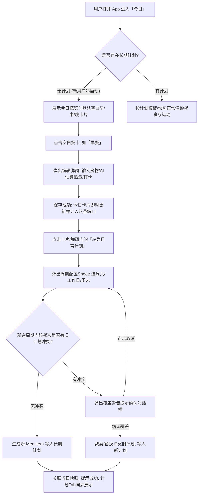

# 无计划默认三餐与一键转计划设计方案

版本：v1.0 ｜ 编写日期：2026-10-01 ｜ 状态：设计完成待开发  
对应需求：冷启动无计划直接记餐、当日餐食一键转为日常周期计划、计划冲突检测与覆盖提示  
配套文档：[需求规格说明书.md](需求规格说明书.md) ｜ [系统架构与技术设计.md](系统架构与技术设计.md) ｜ [当日条目快照与历史固化设计.md](当日条目快照与历史固化设计.md)

---

## 一、 需求背景与设计目标

### 1.1 背景痛点
* **新用户冷启动门槛过高**：目前当用户没有添加或导入计划（`!plan.hasPlan`）时，进入「今日」页直接展示全屏空状态（`EmptyState: 还没有计划，去计划页导入或创建`），阻断了想要直接记账/记餐的用户。
* **从「记录」到「计划」缺少平滑转换途径**：用户往往是在实际生活中吃了某顿饭（例如早饭吃了“两个包子一杯牛奶”并计算了热量），觉得未来几天都会这么吃，希望能一键沉淀为长期计划，而不是重新跑到计划页繁琐地创建计划项。
* **已有计划更新成本高**：当用户的饮食习惯改变时，需要支持用新餐食覆盖旧计划（例如工作日早餐换新方案），且覆盖前需要明确告知冲突并确认。

### 1.2 设计目标
1. **零门槛即开即用**：无计划状态下，今日页默认展示空白的「早、中、晚」三餐卡片，用户无需设置计划即可直接录入食物、AI估算热量、打卡并查看今日热量缺口。
2. **一键转为日常计划**：已填好的餐食条目支持“一键转为计划”，弹窗提供灵活的执行周期配置（快捷工作日、周末、每天及周一至周日独立勾选）。
3. **精准冲突检测与覆盖提示**：当所选周期内已有同餐次计划时，精准识别冲突的星期与旧计划项，弹出二次确认弹窗；确认后安全执行旧计划裁剪或替换。
4. **数据架构与快照一致性**：与现有 F11 当日快照（`DayEntry`）架构无缝兼容，转计划后打卡状态平滑迁移，历史记录不受污染。

---

## 二、 业务链路与交互流程



---

## 三、 详细技术方案

### 3.1 今日页冷启动解禁与空白餐卡生成

#### 页面改造 (`lib/pages/today/today_page.dart`)
* 移除 `if (!plan.hasPlan)` 时的全页 `EmptyState` 拦截。
* 顶部 `CalorieSummary` 正常展示：无计划时摄入目标可按 Onboarding 设置的 TDEE/目标热量显示，实际摄入根据当天已打卡条目实时累加。
* **空白餐卡自动填充逻辑**：
  * 在加载当日快照（`records.getDayEntries(today)`）时，若当天没有任何餐食条目（`mealEntries.isEmpty`），自动补全 3 条空白餐食快照：
    1. **早餐**：`slot: 'breakfast'`, `time: '08:00'`, `content: ''`, `calories: null`, `source: 'manual'`, `planItemId: ''`
    2. **午餐**：`slot: 'lunch'`, `time: '12:00'`, `content: ''`, `calories: null`, `source: 'manual'`, `planItemId: ''`
    3. **晚餐**：`slot: 'dinner'`, `time: '18:30'`, `content: ''`, `calories: null`, `source: 'manual'`, `planItemId: ''`
* **空白卡 UI 表现 (`lib/widgets/meal_card.dart`)**：
  * 若 `entry.content` 为空字符串：
    * 标题显示“早餐 / 午餐 / 晚餐”；
    * 内容行显示灰色提示文本：“点击记录，支持 AI 智能估算”；
    * 右侧操作区：显示灰色编辑图标或“+ 记录”胶囊按钮；未填写内容前不展示打卡圆圈和转计划按钮。

### 3.2 「一键转为日常计划」弹窗与周期选择器

#### 弹窗组件 (`lib/widgets/convert_to_plan_sheet.dart`)
* **触发入口**：
  * **入口 1**：在餐食编辑弹窗（`_EntryEditSheet`）中，当食物内容非空时，底部提供「转为日常计划」按钮。
  * **入口 2**：在 `MealCard` 上，当卡片内容非空时，提供「转为计划」快捷操作图标。
* **界面结构**：
  1. **餐食信息卡片**：展示图标（🥣/🍚/🍽）、餐次名称、时间、食物内容及热量（含蛋白质/碳水/脂肪宏量元素）。
  2. **执行周期选择**：
     * **快捷 Chip**：
       * `[每天]` $\to$ 勾选 `[1, 2, 3, 4, 5, 6, 7]`
       * `[工作日]` $\to$ 勾选 `[1, 2, 3, 4, 5]`
       * `[周末]` $\to$ 勾选 `[6, 7]`
     * **星期选择器**：横向排布 `[一] [二] [三] [四] [五] [六] [日]` 7 个圆形按键，支持任意多选。
     * **双向联动**：手动勾选导致结果刚好为 1-5 时，自动高亮【工作日】；全选时自动高亮【每天】；选中 6-7 时自动高亮【周末】；其它组合时快捷 Chip 取消高亮。
  3. **提醒设置**：提供 Switch 开关「开启用餐提醒」，默认打开。
  4. **确认按钮**：「保存为日常计划」（若未选中任何一天则置灰禁用）。

### 3.3 冲突检测与安全覆盖引擎

#### 冲突检测算法 (`lib/providers/plan_provider.dart`)
* **匹配条件**：
  * 餐次类型相同（`m.type == targetSlot`，如均为 `breakfast`）；
  * 日期交集：旧计划执行星期（若 `days.isEmpty` 视为 `[1..7]`）与新选中的 `selectedDays` 存在交集。
* **收集冲突信息**：
  ```dart
  class PlanConflict {
    final MealItem existingMeal;
    final List<int> conflictDays; // 重叠的星期
  }
  ```
* **二次确认提示框**：
  * 若存在冲突，弹窗列出明确信息，例如：
    > **覆盖已有计划提示**  
    > 检测到以下周几的早餐已存在计划：  
    > • 周一、周二、周三、周四、周五：【燕麦牛奶鸡蛋 (350 kcal)】  
    > 转为新计划后将覆盖上述旧计划，是否继续？  
    > `[取消]`  `[确认覆盖]`

#### 覆盖执行与裁剪逻辑（Partial Trim & Overwrite）
当用户点击【确认覆盖】时：
1. **遍历所有冲突的旧计划项**：
   * 计算移除冲突天数后的剩余天数：$\text{remainDays} = \text{oldDays} \setminus \text{selectedDays}$。
   * **若 $\text{remainDays}$ 为空**：说明旧计划的所有执行天数均被新计划覆盖 $\to$ 从 `plan.meals` 中**彻底删除**该旧项。
   * **若 $\text{remainDays}$ 非空**：说明旧计划在某些天仍需保留（例如旧计划是每天，新计划只覆盖工作日，旧计划在周末仍有效） $\to$ **裁剪旧计划**，将其 `days` 更新为 $\text{remainDays}$。
2. **插入新计划项**：
   * 生成唯一 ID（`genId('m')`），创建新 `MealItem`：
     * `type`: 对应餐次（breakfast/lunch/dinner）
     * `name`: 食物内容
     * `time`: 设定时间
     * `calories`: 设定热量
     * `protein / carbs / fat`: 宏量营养素
     * `days`: `selectedDays`
     * `reminder`: 提醒状态
   * 写入 `plan.meals`。
3. **计划开始日兜底**：
   * 若此前整个计划为空（`plan.meta.startedAt.isEmpty`），将其初始化为今天（`todayStr()`），激活计划体系。
4. **持久化与联动**：
   * 调用 `_persist()` 保存。
   * 重新调度本地闹钟提醒（`_reminder.fullReschedule`）。

### 3.4 当日快照状态同步与打卡迁移

1. **快照条目关联**：
   * 将当前编辑的当日 `DayEntry` 属性更新：
     * `source = 'plan'`
     * `planItemId = newMealItem.id`
     * `detached = false`（恢复为受计划管理的基准条目）
2. **打卡状态无缝迁移**：
   * 如果用户在转计划之前已经在该空白卡上完成了打卡，打卡键原本记录为 `temp:<oldEntryId>`。
   * 转为计划后，将打卡记录无缝迁移为 `meal:<newMealItemId>`，同时清除旧键。
   * 确保用户转计划后，界面上的**绿色打勾状态**和**已摄入卡路里**不会发生突变或消失。

---

## 四、 详细开发实施计划

| 阶段 | 模块 / 任务项 | 涉及文件 | 预估产出 |
| :--- | :--- | :--- | :--- |
| **Phase 1** | **冷启动与空白餐卡默认渲染**<br>• 解除 `TodayPage` 全屏空状态拦截<br>• 实现当日空白三餐（早/中/晚）快照自动注入<br>• `MealCard` 支持空状态视觉与引导录入 | `lib/pages/today/today_page.dart`<br>`lib/providers/record_provider.dart`<br>`lib/widgets/meal_card.dart` | 无计划新用户可直接进入今日页记录早中晚三餐 |
| **Phase 2** | **转计划 UI 与周期选择器**<br>• 封装 `ConvertToPlanSheet` 弹窗组件<br>• 快捷选项（每天/工作日/周末）与 7 天复选联动<br>• 输入项校验（防空选、防无内容） | `lib/widgets/convert_to_plan_sheet.dart`<br>`lib/widgets/meal_card.dart`<br>`lib/pages/today/today_page.dart` | 规范易用的周期选择交互与入参装配 |
| **Phase 3** | **冲突检测与旧计划裁剪覆盖引擎**<br>• `PlanProvider` 增加冲突检测与摘要生成方法<br>• 旧计划全额覆盖删除与部分重叠裁剪算法<br>• 友好的二次确认覆盖弹窗 | `lib/providers/plan_provider.dart`<br>`lib/utils/plan_utils.dart` | 严密可靠的冲突判定与计划安全覆盖能力 |
| **Phase 4** | **快照关联、打卡迁移与跨页同步**<br>• 当日快照绑定 `planItemId`<br>• 打卡状态键迁移（`temp:` $\to$ `meal:`）<br>• 首次转计划激活 `startedAt`，联动 `PlanPage` 和 `StatsPage` | `lib/providers/plan_provider.dart`<br>`lib/providers/record_provider.dart`<br>`lib/pages/plan/plan_page.dart` | 流程闭环，转计划后全 App 各模块状态一致 |
| **Phase 5** | **边界自测与集成验证**<br>• 编写单元测试覆盖覆盖算法边界（全覆盖/部分裁剪/多项重叠）<br>• 全流程回归验收 | `test/plan_conflict_test.dart` | 高质量通过所有验收标准 |

---

## 五、 测试边界与验收用例矩阵

### 1. 冷启动与空白餐卡边界

| 用例编号 | 场景描述 | 操作步骤 | 预期结果 |
| :---: | :--- | :--- | :--- |
| **TC-01** | 全新用户冷启动 | 清除应用全部数据后启动，直接进入「今日」页 | 正常展示今日概览与基础代谢；早餐（08:00）、午餐（12:00）、晚餐（18:30）显示为待录入空白卡；底部保留加餐/运动按钮。 |
| **TC-02** | 仅录入内容未填热量 | 点击空白早餐卡，输入“包子豆浆”，热量留空保存 | 卡片展示“包子豆浆”，热量显示“待补录”，不影响当日已有摄入统计，卡片支持继续编辑或补录热量。 |
| **TC-03** | 空白餐卡未填内容尝试转计划 | 点击空白卡或在空白卡上尝试转计划 | 转计划入口置灰不可点击，或提示“请先完善食物内容和热量”。 |
| **TC-04** | 部分餐次录入 | 仅记录早餐，午餐和晚餐保持空白，退出重新进入 | 早餐保持录入的内容与热量，午餐和晚餐仍维持空白待填状态，互不干扰。 |
| **TC-05** | 跨天自动更新 | 在无计划状态下跨越到第二天（0点后） | 第二天自动生成全新的 3 个空白早中晚卡片，不残留前一天的录入内容。 |

### 2. 周期选择与表单交互边界

| 用例编号 | 场景描述 | 操作步骤 | 预期结果 |
| :---: | :--- | :--- | :--- |
| **TC-06** | 零选择校验 | 打开转计划弹窗，取消所有选中的星期，点击确认 | 确认按钮置灰禁用，或轻提示“请至少选择一天执行该计划”。 |
| **TC-07** | 快捷 Chip 与单选按钮双向联动 | ① 点击【工作日】<br>② 手动勾选【周六】<br>③ 手动取消【周六】 | ① 周一至周五高亮，【工作日】处于选中态；<br>② 周六高亮，【工作日】自动取消选中；<br>③ 重新匹配回周一至周五，【工作日】自动恢复高亮。 |
| **TC-08** | 快捷全选联动 | 手动逐个勾选周一至周日全部 7 天 | 快捷选项【每天】自动变为选中态。 |

### 3. 冲突检测与覆盖判定边界（核心用例）

| 用例编号 | 场景描述 | 初始状态与操作 | 预期判定与结果 |
| :---: | :--- | :--- | :--- |
| **TC-09** | 纯净无计划转计划 | 计划库为空。早餐录入“鸡蛋面包”，选【工作日】转计划 | **无冲突**：直接保存成功；`plan.meals` 新增 1 项（days: 1-5）；计划页同步出现该早餐。 |
| **TC-10** | 同餐次完全重叠覆盖 | 原有早餐计划 A（周一至周五执行）。<br>新早餐 B 选择【工作日】转计划 | **触发完全覆盖冲突**：弹窗提示“周一至周五的早餐已存在计划【A】，是否覆盖？”<br>确认后：旧计划 A 被**完全移除**，新计划 B 生效。 |
| **TC-11** | 跨周期部分覆盖（部分裁剪） | 原有早餐计划 A（每天执行，`days=[]` 或 `1-7`）。<br>新早餐 B 选择【工作日 (1-5)】转计划 | **触发部分覆盖冲突**：提示“周一至周五已存在早餐【A】，是否覆盖？”<br>确认后：旧计划 A 不被删除，但其 `days` 被裁剪为 `[6, 7]`（仅周末执行）；新计划 B 在工作日执行。 |
| **TC-12** | 逆向部分覆盖 | 原有早餐计划 A 仅在【工作日 (1-5)】执行。<br>新早餐 B 选择【每天 (1-7)】转计划 | **触发覆盖冲突**：提示“周一至周五已存在早餐【A】”。<br>确认后：旧计划 A 被完全覆盖删除；新计划 B（每天）生效。 |
| **TC-13** | 多项混合冲突检测 | 原早餐 A（周一、二），原早餐 B（周三至五）。<br>新早餐 C 选择【工作日 (1-5)】转计划 | **多项目综合冲突**：提示“周一、周二的早餐【A】及周三至周五的早餐【B】将被覆盖，是否确认？”<br>确认后：旧计划 A 和 B 均被正确清理，新计划 C 成功接管。 |
| **TC-14** | 异餐次互不影响 | 原计划已有“午餐”和“晚餐”。用户将今日“早餐”转为计划 | **无冲突**：不同餐次互不干扰，直接新增早餐计划。 |
| **TC-15** | 放弃覆盖操作 | 出现冲突弹窗后，点击【取消】 | 中止保存流程，旧计划完整保留，新计划不生效，停留在周期编辑弹窗中。 |

### 4. 快照联动与系统级测试边界

| 用例编号 | 场景描述 | 操作步骤 | 预期结果 |
| :---: | :--- | :--- | :--- |
| **TC-16** | 已打卡状态保持 | 在空白早餐卡上录入内容并打上勾（打卡），随后执行转计划 | 转计划成功后，当天的卡片依然保持**已打卡（打勾）**状态，热量统计中已摄入值保持一致，不被重置。 |
| **TC-17** | 计划页同步承接 | 首次在无计划下完成转计划后，切换到底部「计划」Tab | 计划页告别空状态，顶部展示“减脂计划”，餐食列表能看到刚刚新转入的早餐项目，且展示对应的周几标签。 |
| **TC-18** | 统计页承接 | 首次转计划后，切换到底部「统计」Tab | 统计页不再显示“暂无统计数据”，当天打卡与热量差额能够正确纳入统计。 |
| **TC-19** | 备份与还原兼容 | 执行过“一键转计划”后，在设置中导出备份并重新导入 | 导出的 JSON 数据结构完全符合旧版与当前版本的 `MealItem` 规范，导入后周期与名称完全一致。 |

---

**文档元信息**
- 所属版本：v1.1.0（零门槛冷启动与一键转计划）
- 创建时间：2026年10月01日
